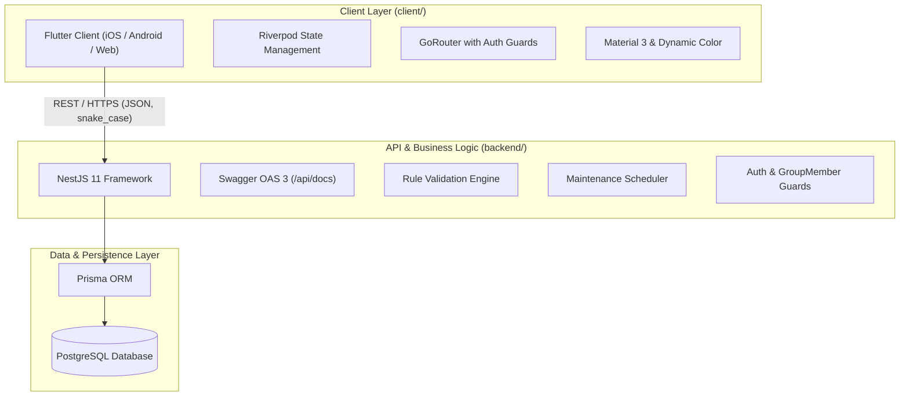
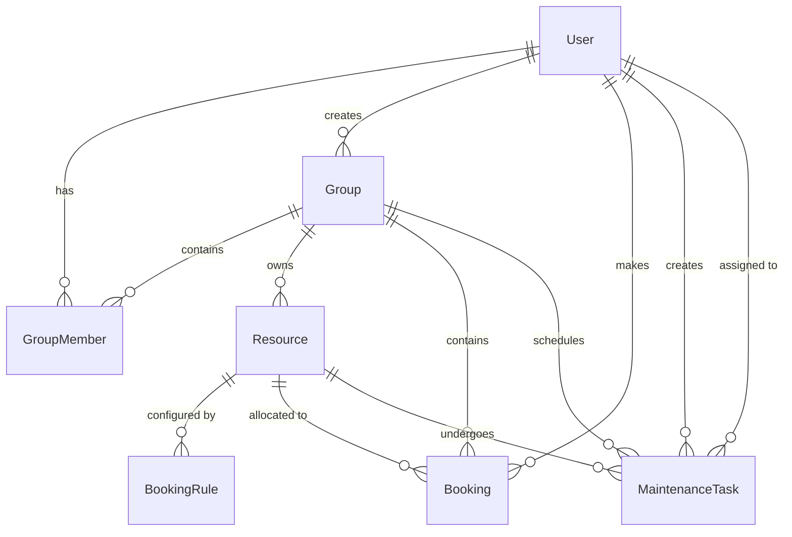
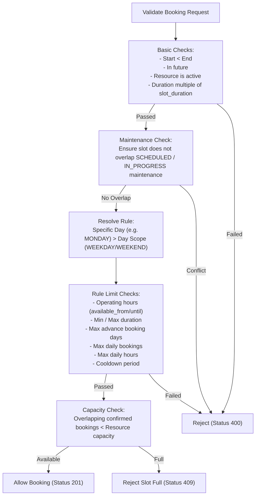

# Lock My Slot — Functional Specification & System Architecture

## 1. Executive Summary

**Lock My Slot** is a multi-tenant resource booking and scheduling platform built for clubs, shared workspaces, laboratories, sports facilities, residential amenities, and small organizations. 

The system enables organizations to establish self-contained **Groups**, invite members via secure codes, define shared **Resources** (e.g., courts, meeting rooms, 3D printers), enforce granular **Booking Rules** (cooldowns, daily limits, operating hours), schedule **Maintenance Tasks**, and empower members to book slots seamlessly through a modern mobile and web interface.

---

## 2. Architecture & Tech Stack



### Technology Matrix

| Layer | Component | Technologies |
| :--- | :--- | :--- |
| **Backend** | Framework | **NestJS 11** (TypeScript, Express) |
| | ORM & Database | **Prisma ORM** with **PostgreSQL** |
| | Authentication | Bearer Auth Token + Credential Auth (bcrypt) |
| | Documentation | **OpenAPI 3.0 / Swagger** at `/api/docs` |
| | Testing | Jest, Supertest (Unit & End-to-End test suites) |
| **Frontend** | Framework | **Flutter 3.x** (Dart) |
| | State Management | **Riverpod** with code generation (`riverpod_generator`) |
| | Routing | **GoRouter** with redirect-based route protection |
| | UI Design | Material 3 with `dynamic_color` adaptive theming |
| | Storage | `flutter_secure_storage` for tokens, local cache for offline |

---

## 3. Data Models & Relationships



### Core Entities

1. **User (`users`)**:
   - `id` (UUID v4): Primary identifier.
   - `username` (string, unique, optional): Unique handle for password-based logins.
   - `password_hash` (string, optional): Bcrypt-hashed password.
   - `display_name` (string): Friendly name shown to other members.
   - `auth_token` (UUID, unique): High-entropy bearer token for API authorization.

2. **Group (`groups`)**:
   - `id` (UUID v4): Group identifier.
   - `name` (string): Group name (e.g., "Makerspace Club", "Badminton Court 1").
   - `invite_code` (string, unique): 6-character alphanumeric uppercase code (e.g., `AB12CD`).
   - `created_by` (UUID): Reference to the founding user.

3. **GroupMember (`group_members`)**:
   - `groupId` & `userId`: Unique compound key.
   - `role`: Enum `ADMIN` or `MEMBER`.
   - `joinedAt`: Timestamp when the user joined.

4. **Resource (`resources`)**:
   - `id` (UUID v4): Resource identifier.
   - `group_id` (UUID): Group owning the resource.
   - `name` (string) & `description` (optional string).
   - `capacity` (int, default: 1): Simultaneous booking concurrency limit.
   - `slot_duration_minutes` (int, default: 30): Discrete booking step size (e.g., 15, 30, 60 mins).
   - `is_active` (boolean, default: true): Soft-delete / active toggle.

5. **BookingRule (`booking_rules`)**:
   - `resource_id` (UUID): Target resource.
   - `day_scope`: Enum `WEEKDAY`, `WEEKEND`, or specific day (`MONDAY`, `TUESDAY`, etc.).
   - Constraints:
     - `available_from` & `available_until`: Operating hours in UTC `"HH:mm"`.
     - `min_duration_minutes` & `max_duration_minutes`: Duration boundaries.
     - `max_bookings_per_day`: Daily booking count quota per user.
     - `max_hours_per_day`: Total hours allowed per user per day.
     - `cooldown_minutes`: Minimum gap required between consecutive bookings by the same user.
     - `max_advance_booking_days`: How far ahead in the future slots can be booked.

6. **Booking (`bookings`)**:
   - `resource_id`, `group_id`, `user_id`.
   - `start_time` & `end_time`: UTC timestamps aligned with slot boundaries.
   - `status`: Enum `CONFIRMED` or `CANCELLED`.

7. **MaintenanceTask (`maintenance_tasks`)**:
   - `resource_id`, `group_id`, `created_by`, `assigned_to` (optional).
   - `title`, `description`.
   - `status`: Enum `SCHEDULED`, `IN_PROGRESS`, `COMPLETED`, `CANCELLED`.
   - `recurrence_type`: Enum `NONE`, `DAILY`, `WEEKLY`.
   - `day_of_week`: `0` (Sunday) through `6` (Saturday) for weekly recurrence.
   - `start_time_of_day` & `end_time_of_day`: Operating time window in UTC `"HH:mm"`.
   - `start_time` & `end_time`: Overall task boundary.

---

## 4. Key Functional Modules

### 4.1 Authentication & Profile Management
- **Registration**: Supports quick registration by `display_name` (generating an instant `auth_token`), or standard registration with `username` and `password`.
- **Login**: Authenticate with `username` and `password` to retrieve the user's `auth_token`.
- **Bearer Token Auth**: All protected endpoints require header `Authorization: Bearer <auth_token>`.
- **Profile Self-Service**:
  - `GET /api/v1/auth/me`: Fetches profile details, user ID, display name, and username.
  - `PATCH /api/v1/auth/me`: Updates display name.

### 4.2 Group Management & Multi-Tenancy
- **Isolation**: Resources, rules, bookings, and maintenance tasks are strictly scoped to their group.
- **Group Creation**: Any authenticated user can create a group; the creator is automatically assigned the `ADMIN` role.
- **Invite Codes**:
  - Automatically generated 6-character alphanumeric code upon creation.
  - Admins can regenerate the invite code at any time (`POST /api/v1/groups/:id/regenerate_invite`), immediately invalidating old codes.
- **Joining Groups**: Users join by submitting an active invite code (`POST /api/v1/groups/join`).
- **Membership & Roles**:
  - `ADMIN`: Has full privileges (edit group, manage members, create/update/delete resources, configure booking rules, schedule maintenance, cancel any member's bookings).
  - `MEMBER`: Can view resources, check availability, book slots, view group maintenance, and manage their own bookings.
- **Group Exit Rules**:
  - Admins cannot remove themselves or delete other admins without proper reassignment.
  - A user who is the sole admin cannot leave the group until another admin is designated.

### 4.3 Resource Administration
- Admins can create resources under a group with a specified capacity and slot duration.
- Supports updating details (name, description, capacity, slot duration).
- **Soft Deletion**: Resources can be deactivated (`is_active = false`). Inactive resources cannot be booked. Inactive resources are hidden from standard members but can be inspected by Admins with `?include_inactive=true`.

### 4.4 Booking Rules Engine
Before any booking is confirmed, the **Rules Engine** (`RulesService`) executes a multi-step validation pipeline:



1. **Resolution Precedence**: Day-specific rules (`MONDAY`, `TUESDAY`, etc.) take precedence over grouped day scopes (`WEEKDAY` or `WEEKEND`).
2. **Cooldown Guard**: Prevents members from hoarding slots consecutively; requires an interval of `cooldown_minutes` between bookings by the same user.
3. **Availability Window**: Ensures requests fall entirely inside allowed operational hours (e.g. `08:00` to `22:00` UTC).

### 4.5 Slot Availability & Booking Workflow
- **Availability Matrix** (`GET /groups/:group_id/resources/:resource_id/availability?date=YYYY-MM-DD`):
  - Generates all slots for the specified day based on `slot_duration_minutes`.
  - Computes remaining capacity for each slot after factoring in confirmed bookings and maintenance blocks.
  - Returns user-specific quota statistics (e.g., remaining bookings and hours for that day).
- **Booking Creation** (`POST /groups/:group_id/resources/:resource_id/bookings`):
  - Validates slot parameters and enforces concurrency limits.
  - Rejects with `409 Conflict` if capacity is exceeded.
- **Cancellation** (`DELETE /groups/:group_id/bookings/:id`):
  - Members can cancel their own upcoming bookings.
  - Admins can cancel any booking in the group.
  - Past bookings cannot be cancelled.
- **Rescheduling** (`PATCH /groups/:group_id/bookings/:id`):
  - Members can reschedule their own upcoming bookings to an open time slot.
  - Admins can reschedule any member's booking.
  - Validates the new slot against booking rules, maintenance blocks, and resource capacity (excluding the booking itself from conflict checks).
  - Past and cancelled bookings cannot be rescheduled.

### 4.6 Maintenance & Task Management System
- **Purpose**: Allows facility managers and admins to take resources offline for inspections, repairs, or cleaning.
- **Task Types**:
  - **One-off**: Fixed start and end time.
  - **Daily Recurring**: Occurs daily within specific hours (`start_time_of_day` to `end_time_of_day`).
  - **Weekly Recurring**: Occurs on a designated `day_of_week` (0 = Sunday ... 6 = Saturday) within the specified daily window.
- **Status Lifecycle**:
  `SCHEDULED` ➔ `IN_PROGRESS` ➔ `COMPLETED` or `CANCELLED`.
- **Assignee Support**: Tasks can be assigned to any member of the group (`assignedToId`). Both Admins and the designated assignee can update task status and details.
- **Conflict Handling**:
  - Creating or rescheduling maintenance checks for overlapping confirmed bookings.
  - If conflicts exist, the API responds with `409 Conflict` containing the list of affected bookings.
  - When the admin sets `cancel_conflicting_bookings: true`, the system automatically cancels the conflicting bookings in a single transaction.

---

## 5. Mobile & Web Client (Flutter)

The Flutter application provides a responsive, accessible client experience:

- **State Management & Architecture**: Built with Riverpod (`AsyncNotifier`, `Notifier`) and repository pattern for predictable state flow.
- **Authentication & Deep Linking**:
  - Persists tokens via `flutter_secure_storage`.
  - Supports deep links and login redirection (`returnTo` parameter preservation).
  - Automatically redirects unauthenticated users to `/login`.
- **Navigation & Screens**:
  - **Auth**: Login and Registration screens.
  - **Shell / Home**: Group switcher, global quick booking, member bookings list, profile settings.
  - **Group Management**: Group details, member roster, role administration, invite code sharing.
  - **Resource Detail & Calendar**: Visual time slot selector, slot status indicators (available, limited, full, maintenance).
  - **Maintenance Portal**: Task creation, assignment picker, status filter, and conflict resolution modal.
- **Resilience**: Client includes offline caching strategies for cached viewing of bookings and group resources when disconnected.

---

## 6. Complete API Reference

Base URL prefix: `/api/v1`

### 6.1 Authentication (`/auth`)
| Method | Path | Auth | Description |
| :--- | :--- | :--- | :--- |
| `POST` | `/auth/register` | None | Register a new user (`display_name`, optional `username`, `password`). Returns `auth_token`. |
| `POST` | `/auth/login` | None | Login with `username` and `password`. Returns `auth_token`. |
| `GET` | `/auth/me` | Bearer | Get current user's profile information. |
| `PATCH` | `/auth/me` | Bearer | Update current user's `display_name`. |

### 6.2 Groups (`/groups`)
| Method | Path | Auth | Role | Description |
| :--- | :--- | :--- | :--- | :--- |
| `POST` | `/groups` | Bearer | Any | Create a group; creator becomes `ADMIN`. |
| `GET` | `/groups` | Bearer | Any | List all groups the current user belongs to. |
| `POST` | `/groups/join` | Bearer | Any | Join a group using a 6-character `invite_code`. |
| `GET` | `/groups/:id` | Bearer | Member | Get group details. |
| `PATCH` | `/groups/:id` | Bearer | Admin | Update group name. |
| `GET` | `/groups/:id/members` | Bearer | Member | List all members and their roles. |
| `DELETE`| `/groups/:id/members/:user_id` | Bearer | Admin | Remove a member from the group. |
| `POST` | `/groups/:id/leave` | Bearer | Member | Voluntarily leave group (sole admin protected). |
| `POST` | `/groups/:id/regenerate_invite`| Bearer | Admin | Regenerate a fresh invite code. |

### 6.3 Resources (`/groups/:group_id/resources`)
| Method | Path | Auth | Role | Description |
| :--- | :--- | :--- | :--- | :--- |
| `POST` | `/groups/:group_id/resources` | Bearer | Admin | Create a new resource. |
| `GET` | `/groups/:group_id/resources` | Bearer | Member | List resources (`?include_inactive=true` for admins). |
| `GET` | `/groups/:group_id/resources/:id` | Bearer | Member | Get resource details and active booking rules. |
| `PATCH` | `/groups/:group_id/resources/:id` | Bearer | Admin | Update resource (name, capacity, slot duration, active). |
| `DELETE`| `/groups/:group_id/resources/:id` | Bearer | Admin | Soft-delete resource (`is_active = false`). |

### 6.4 Booking Rules (`/groups/:group_id/resources/:resource_id/rules`)
| Method | Path | Auth | Role | Description |
| :--- | :--- | :--- | :--- | :--- |
| `GET` | `.../rules` | Bearer | Member | Get all booking rules configured for the resource. |
| `PUT` | `.../rules` | Bearer | Admin | Bulk upsert / replace booking rules for day scopes. |

### 6.5 Bookings (`/groups/:group_id`)
| Method | Path | Auth | Role | Description |
| :--- | :--- | :--- | :--- | :--- |
| `POST` | `/groups/:group_id/resources/:resource_id/bookings` | Bearer | Member | Create booking after rule & capacity validation. |
| `GET` | `/groups/:group_id/resources/:resource_id/bookings` | Bearer | Member | List bookings for a resource (`?from=...&to=...`). |
| `GET` | `/groups/:group_id/resources/:resource_id/availability` | Bearer | Member | Get available time slots and user limits for a date. |
| `GET` | `/groups/:group_id/my_bookings` | Bearer | Member | List current user's bookings (`?status=CONFIRMED`). |
| `PATCH`| `/groups/:group_id/bookings/:id` | Bearer | Owner/Admin | Reschedule booking to a new time slot. |
| `DELETE`| `/groups/:group_id/bookings/:id` | Bearer | Owner/Admin | Cancel booking. |

### 6.6 Maintenance Tasks (`/groups/:group_id`)
| Method | Path | Auth | Role | Description |
| :--- | :--- | :--- | :--- | :--- |
| `POST` | `/groups/:group_id/resources/:resource_id/maintenance` | Bearer | Admin | Schedule a maintenance task (handles conflicts/overrides). |
| `GET` | `/groups/:group_id/resources/:resource_id/maintenance` | Bearer | Member | List maintenance tasks for a specific resource. |
| `GET` | `/groups/:group_id/maintenance` | Bearer | Member | List all maintenance tasks across the group. |
| `GET` | `/groups/:group_id/resources/:resource_id/maintenance/:task_id` | Bearer | Member | Get details of a maintenance task. |
| `PATCH` | `/groups/:group_id/resources/:resource_id/maintenance/:task_id` | Bearer | Admin/Assignee | Update task status, timing, or details. |
| `DELETE`| `/groups/:group_id/resources/:resource_id/maintenance/:task_id` | Bearer | Admin | Delete / cancel a maintenance task. |

---

## 7. Security & Error Handling

- **Error Format**: All errors return a standardized JSON envelope:
  ```json
  {
    "statusCode": 400,
    "error": "Bad Request",
    "message": "booking_rule_violation",
    "details": ["cooldown: 30min required after previous booking"]
  }
  ```
- **HTTP Status Codes**:
  - `200 OK` / `201 Created` / `204 No Content`
  - `400 Bad Request`: Validation failure or business rule violation.
  - `401 Unauthorized`: Missing or invalid Bearer token / credentials.
  - `403 Forbidden`: Insufficient role (e.g. member attempting admin action) or non-member.
  - `404 Not Found`: Entity does not exist within the specified group.
  - `409 Conflict`: Slot fully booked, or conflicting bookings exist during maintenance scheduling.
